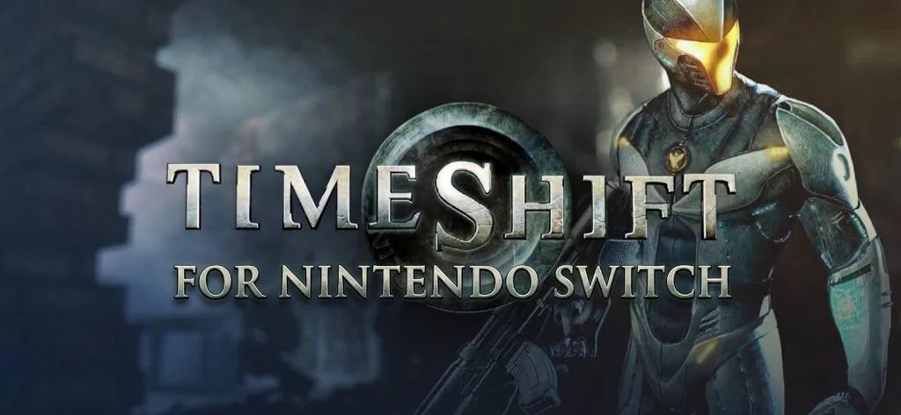

[English](README.md) | [Русский](README_RU.md)



# timeshift-nx

**TimeShift** (Xbox 360 version) native port for **Nintendo Switch** using static recompilation and the native `deko3d` graphics API.

Releasing the project as-is.

I am not a professional programmer - I built this port with the help of AI tools. The project has reached a working, playable state on physical Nintendo Switch hardware: it compiles into a standalone `.nro` file, runs natively without emulators, plays cutscenes, operates menus, saves progress and checkpoints, loads campaign levels, and supports controls, physics, and time manipulation mechanics. Gameplay runs at ~25-35+ FPS at 720p on retail hardware after CPU/GPU optimization passes, while **audio quality is currently poor/broken and has not been fixed yet**.

If you have experience with low-level Switch development (deko3d, Nvidia Maxwell GM20B, Direct3D 9 / Xbox 360 Xenos) or Switch audio and would like to help improve audio or optimize performance further, you are welcome to contribute! Send your improvements via Pull Requests: working PRs will be gladly reviewed and merged so the port continues to evolve.

---

## Project Completion Status

Overall Port Readiness: **`[████████░░] 85%`**

| Subsystem | Progress | Status |
|---|---|---|
| **Core, Memory, Saves & Controls** | `█████████░` **95%** | Static recompilation, 2.4–3.0 GB heap, `o1heap`, saves/checkpoints, Joy-Con/Pro, time powers |
| **Graphics & Shaders (`deko3d`)** | `██████████` **98%** | `5,403` GLSL / `6,287` `uam`-compiled shaders across campaign levels, sharp mipmaps/POM, soft particles, `Hold +` overlay menu |
| **Audio (`XMA2` / `audout`)** | `███░░░░░░░` **30%** | *Currently sounds terrible (crackling/distortion/stuttering) — not yet worked on* |
| **Performance (Switch Hardware)** | `████████░░` **80%** | Playable `~25-35+ FPS` (`1280x720`) via `-O3`, 4-core pinning, ZCull, lock-free registry & D3D ring bypass |

---

## What Works Right Now

- **Static Recompilation:** Original Xbox 360 guest code compiled directly to 64-bit ARM (AArch64) for Horizon OS.
- **Native Renderer:** Runs via Nintendo Switch native `deko3d` API (direct hardware access to Tegra X1 GPU).
- **Complete Campaign Shader Cache & Sharp Textures:** `5,403` translated GLSL shaders and `6,287` patched-`uam` `DKSH` binaries (`deko3d_shaders_f0.bin`, `0` missing in tested areas) + Xenos `GetTextureGradients` support restoring high-resolution mipmaps and Parallax Occlusion Mapping with zero glowing or flickering objects.
- **Fire, Smoke & Explosions (Soft Particles):** Conditional EDRAM 4xMSAA aliasing (`640x360` soft-particle buffers onto `1280x720` targets) restores campfires, volumetric smoke, grenades, and explosion effects with intact 1:1 camera framing.
- **In-Game Graphics & Level Menu (`Hold +`):** Real-time FPS/GPU HUD, toggles for shadows, draw distance, VSync, anisotropic filtering, D3D ring bypass, ZCull, depth compression, and a 24-level campaign `LEVEL JUMP` selector.
- **Save System & Checkpoints:** Fully implemented and working! Profile saves, new game autosaves, and in-game checkpoints are created and loaded properly on Horizon OS SD card storage (`sdmc:/switch/timeshift/user/`).
- **Intro Cutscenes:** Bink Video playback works.
- **UI & Menus:** Main menu, options, profile save/load, pause screen are all working.
- **In-Game Gameplay:** Campaign levels load and play cleanly.
- **Controls & Input:** Full support for Joy-Cons and Pro Controller (simultaneous dual-input for handheld and docked play).
- **Suit Abilities:** Slow time, time stop, and time rewind affect the world and physics correctly.
- **Weather & Storm Occlusion:** Atmospheric lightning flashes and volume light properly occluded inside rooms (fixed by Oleksa126).
- **Auto-Sleep Inhibition:** Screen dimming and auto-sleep are disabled during gameplay.
- **Memory Management:** Dynamic process heap with native ARM64 `o1heap` guest allocator and backing memory granule recycling.
- **Performance:** Playable ~25-35+ FPS at 720p on retail Switch hardware.

---

## Known Issues (What Needs Fixing)

If anyone decides to pick this up, here are the main remaining areas that need attention:

### 1. Poor Audio Quality (Not Yet Fixed)
* **Symptom:** In-game audio currently sounds terrible (heavy distortion, crackling, and stuttering), especially during gameplay and multi-channel combat. We have not worked on fixing audio yet.
* **Technical details:** XMA2 decoder (`private/sdk/src/audio/xma_decoder.cpp`) and `AudioWorker` / `audout` buffering (`private/sdk/src/audio/audio_system.cpp`). Needs proper XMA2 stream/frame decoding and asynchronous offloaded mixing.

### 2. Further Performance Headroom in Heavy Scenes
* **Symptom:** Heavy outdoor combat scenes with 600–700+ draw calls can still dip below 30 FPS when full shadows are enabled (toggleable via `Hold +` menu).

*(Previously listed texture LOD, glowing/flickering objects, black silhouettes, shadow dashes, and `10-15 FPS` bottlenecks were addressed in Parts 270–290 via `GetTextureGradients`, conditional EDRAM 4xMSAA aliasing, `5,403`-shader patched-`uam` rebuild, depth-compression control, `-O3`, 4-core pinning, ZCull, lock-free `DeviceRegistry`, and `renut_skip_orig_d3d`.)*

---

## Directory Structure

```
timeshift-nx/
|-- adapter/              # C++ adapter layer bridging game calls to deko3d & Switch
|   |-- timeshift_app.cpp          # Application lifecycle and initialization
|   |-- renut_tuning_shims.cpp     # Depth, ZCull, Hold+ menu, level-jump & EDRAM hooks
|   |-- perf_breakdown.h           # Telemetry HUD & campaign level table
|   |-- draw_hooks.cpp             # Render pass interception & D3D bypass
|   `-- tiling_hooks.cpp           # XGraphics texture tiling hooks
|-- upstream/sa2-nx/      # renut_engine runtime (deko3d backend, shader translator, overlay)
|-- private/              # SDK (audio, kernel, memory) and recompiled C++ sources
|   |-- app/generated/             # Recompiled game code (timeshift_recomp.*.cpp)
|   `-- sdk/                       # rexglue (audio, kernel, memory)
|-- tools/                # Build and deployment scripts
|   |-- build_switch_app.py        # Links timeshift.nro
|   |-- prepare_switch_cache.py    # Prepares shaders and assets
|   `-- deploy_candidate.py        # Deploys to Switch via FTP
|-- MODLOG.md             # Development chronicle (Parts 270-290; earlier in archives)
|-- deko3d_shaders_f0.bin # Precompiled deko3d shader cache (6,287 records)
`-- timeshift.toml        # Game configuration file for Switch
```

---

## How to Build

### Prerequisites:
- **devkitPro** with packages:
  - `devkitA64` (`aarch64-none-elf-g++`)
  - `libnx`
  - `deko3d`
- **Linux or WSL2** (Ubuntu/Debian).
- **Python 3.10+**, **CMake**, **Ninja**.

### Build Commands:

1. **Build internal runtime (`rexruntime`):**
   ```bash
   cd private/sdk
   ninja -C /path/to/switch-build rexaudio rexruntime
   ```

2. **Build Switch binary (`timeshift.nro`):**
   ```bash
   python3 tools/build_switch_app.py
   ```
   The output binary will be created at: `build/app-switch/timeshift.nro`.

---

## Running on Nintendo Switch

> **Important:** Original game assets are copyrighted and NOT included in this repository. You must supply your own extracted TimeShift game files (Xbox 360 version).

1. Create a folder on your Switch SD card:
   ```
   /switch/timeshift/
   ```
2. Copy the following files into that folder:
   - `timeshift.nro`
   - `timeshift.toml`
   - `deko3d_shaders_f0.bin`
   - `game/` folder with extracted TimeShift game data.
3. **Launch ONLY via Title Override:**  
   Hold **R** while launching any installed retail game on your Switch to open hbmenu with full memory access.  
   *Do NOT launch via the Album (Applet Mode), or the game will crash due to out-of-memory errors!*

---

## In-Game Graphics & Level Menu (`Hold +`)

Hold **`+`** for ~0.5 seconds at any time (main menu or in-game) to open the **RENUT GRAPHICS MENU**.  
*(A quick tap of `+` still opens the normal game pause menu.)*

- **Controls:** `D-Pad Up/Down` to move, `D-Pad Left/Right` or `A` to change, `B` or `Hold +` to close.

| Option | Values | Description |
|---|---|---|
| **FPS HUD** | `ON` / `OFF` | Shows/hides real-time FPS, min FPS, frame time, and GPU time at the top |
| **SHADOWS 1024** | `ON` / `OFF` | Toggles dynamic 1024x1024 shadow maps (turn `OFF` for extra FPS in heavy scenes) |
| **DRAW DIST** | `MAX`, `200M`, `120M`, `80M`, `55M`, `40M` | Caps camera far-plane draw distance |
| **VSYNC** | `ON` / `OFF` | Toggles vertical synchronization |
| **ANISO FILTER** | `Game`, `2x`, `4x`, `8x` | Anisotropic texture filtering level |
| **SKIP D3D COPY** | `ON` / `OFF` | Bypasses redundant original Xbox D3D ring-buffer writes/copies |
| **ZCULL RST** | `ON` / `OFF` | Hardware ZCull optimization *(restart required)* |
| **DEPTH CMP RST** | `ON` / `OFF` | Hardware depth compression *(restart required; keep `OFF` if shadow grid dashes appear)* |
| **LEVEL JUMP** | `OFF`, `01 CITY 1` .. `24 FINAL` | Replaces the next loaded campaign map with the selected level (via New Game / Continue / Restart) |
| **SAVE CONFIG** | `APPLY` | Saves current settings to `sdmc:/switch/timeshift/timeshift.toml` |

---

## How to Contribute (Pull Requests)

If you manage to fix any of the remaining issues or improve performance:
1. **Fork** this repository to your own GitHub account.
2. Commit your fixes in your fork.
3. Submit a **Pull Request** to this repository.
4. Working pull requests will be reviewed and merged promptly.

---

## Credits & Acknowledgments

- **[@Oleksa126](https://github.com/Oleksa126) (Oleksandr Bazavliak):**  
  Special thanks and deep gratitude for his fork ([Oleksa126/timeshift-nx](https://github.com/Oleksa126/timeshift-nx)), which contributed:
  - Dynamic heap initialization via `__libnx_initheap` (~2.4 GB process RAM) preventing out-of-memory crashes.
  - Backing memory granule pooling and decommit rounding in `guest_memory_switch.cpp`.
  - Fix for `EncodeUnorm24` depth overflow in `depth_resolve.hlsli`, which resolved the fullscreen depth-of-field blur issue.
  - Fix for storm and weather lightning occlusion through indoor walls in `pipeline.cpp`.
  - Texture header protection for GPU-written surfaces during dynamic streaming.
  - GPU submit telemetry and draw history tracking.
- **ReX / xenia team:** For foundational Xbox 360 static recompilation and emulation research.
- **devkitPro & switchbrew team:** For `libnx`, `deko3d`, and the homebrew toolchain.

---

## License & Disclaimer

TimeShift is a registered trademark of Saber Interactive / Sierra / Activision. This repository is an unofficial, non-commercial reverse-engineering and static recompilation research project.

The source code in this repository is distributed for educational and research purposes under the terms of the BSD 3-Clause License and applicable upstream licenses. Original game assets (models, textures, audio, game scripts) are copyrighted by their respective owners and are NOT included in this repository.
