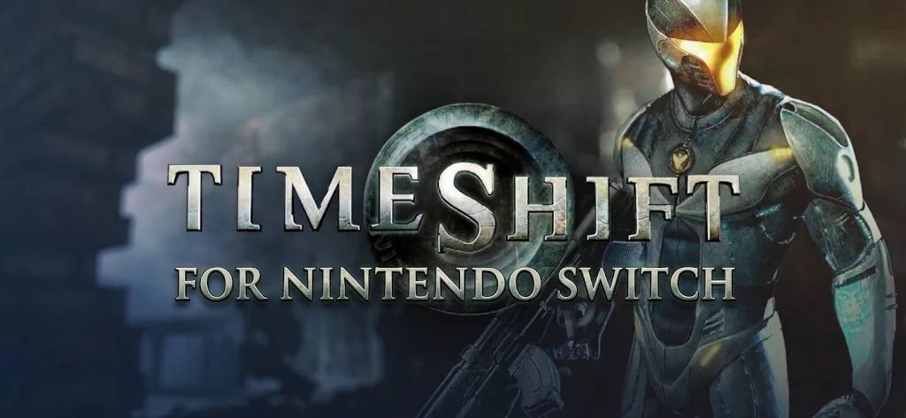

<div align="center">

[English](README.md) | [Русский](README_RU.md)

<br />



# TimeShift NX

**Нативный порт TimeShift (версия Xbox 360) для Nintendo Switch на базе статической рекомпиляции и `deko3d`**

<p align="center">
  
  
  
  
</p>

<p align="center">
  <a href="https://boosty.to/vasin228">
    
  </a>
</p>

</div>

---

Проект доведён до рабочего состояния на реальной консоли Nintendo Switch: игра собирается в один файл `.nro`, запускается нативно через `deko3d` без эмуляторов, видеоролики играют, меню работает, сохранения и чекпоинты функционируют, уровни кампании загружаются, управление, физика, механики времени, чистый звук XMA2/FMOD и полная база шейдеров кампании (`15,961` GLSL / `16,827` вариантов `uam`) работают на реальной консоли (~25-35+ FPS в 720p).

Pull Request'ы и предложения приветствуются.

---

## Шкала готовности проекта

Общая готовность порта: **`[█████████░] 95%`**

| Подсистема | Прогресс | Статус |
|---|---|---|
| **Ядро, память, сохранения и управление** | `█████████░` **95%** | Статическая рекомпиляция, пул 2.4–3.0 ГБ, `o1heap`, сохранения/чекпоинты, Joy-Con/Pro, механики времени |
| **Графика и шейдеры (`deko3d`)** | `██████████` **100%** | `15,961` GLSL / `16,827` скомпилированных шейдеров со всех 26 архивов `.s3dpak` и 4 `.sdrc`, чёткие мипмапы и рельеф, мягкие частицы, меню по удержанию `+` |
| **Звук (`XMA2` / `audout`)** | `█████████░` **95%** | Чистый звук XMA2 + FMOD Ex + `audout` в реальном времени (пейсинг 4.6 мс, буферы 2048 Б, 8 XMA-контекстов inline, пиннинг ядер 1/2) |
| **Производительность (Switch)** | `████████░░` **80%** | Играбельно при `~25-35+ FPS` (`1280x720`) за счёт `-O3`, пиннинга 4 ядер, ZCull, lock-free реестра и обхода D3D ring |

---

## Что сейчас работает

- **Статическая рекомпиляция:** Код Xbox 360 скомпилирован напрямую под 64-битный ARM (Horizon OS).
- **Нативный рендерер:** Работает через нативный API Switch `deko3d` (прямой доступ к GPU Tegra X1).
- **Чистый звук (`XMA2` / `FMOD` / `audout`):** Пейсинг `AudioWorker` с интервалом 4.6 мс, буферы `audout` по 2048 Б (`2` гостевых кадра), декодирование до `8` XMA-контекстов inline и закрепление потоков на ядрах 1/2 устранили заикания и металлические искажения речи и эффектов.
- **Полный кэш шейдеров из всех архивов игры и чёткие текстуры:** `15,961` транслированных GLSL-шейдеров и `16,827` собранных патченным `uam` бинарников (`shader_cache_switch.cpp` + `deko3d_glsl.bin` + `deko3d_shaders_f0.bin` со всех 26 `.s3dpak` и 4 `.sdrc`) + поддержка `GetTextureGradients` и ненулевая страховка в `shader_library.cpp` убрали чёрные силуэты, светящиеся модели и низкие мипмапы.
- **Эффекты огня, дыма и взрывов (Soft Particles):** Условный алиасинг EDRAM 4xMSAA (`640x360` буфер мягких частиц поверх основного кадра `1280x720`) вернул костры, объёмный дым, гранаты и взрывы при корректной 1:1 геометрии камеры.
- **Внутриигровое меню (`Hold +`):** Оверлей FPS/GPU, переключатели теней, дальности прорисовки, VSync, анизотропной фильтрации, обхода D3D-копий, ZCull, сжатия глубины и выбор любого из 24 уровней кампании (`LEVEL JUMP`).
- **Система сохранений и чекпоинтов:** Полностью реализована и работает! Сохранение профиля, автосохранение новой игры и чекпоинты корректно записываются и загружаются с SD-карты (`sdmc:/switch/timeshift/user/`).
- **Вступительные ролики:** Bink Video работают.
- **Интерфейс и меню:** Главное меню, экран настроек, сохранение профиля, пауза - все работает.
- **Геймплей:** Уровни кампании загружаются и проходятся без вылетов.
- **Управление и контроллеры:** Полная поддержка Joy-Con и Pro Controller (одновременная работа в портативном и стационарном режимах).
- **Способности костюма:** Замедление, остановка и перемотка времени влияют на мир и физику корректно.
- **Освещение погоды и грозы:** Вспышки молний и объемный свет корректно перекрываются геометрией комнат и крышами (исправлено Oleksa126).
- **Защита от засыпания:** Экран не гаснет и консоль не уходит в спящий режим во время игры.
- **Управление памятью:** Динамический пул кучи с нативным ARM64-аллокатором `o1heap` и повторным использованием страниц гостевой памяти.
- **Производительность:** Играбельные ~25-35+ FPS в 720p на реальной Switch.

---

## Известные проблемы (что осталось сделать)

### 1. Запас производительности в тяжёлых сценах
* **Симптом:** В сценах с плотными взрывами и физикой обломков (например, на дирижабле `ts2_zepride1_part01`) FPS держится на уровне `~20–23 FPS` из-за упора в однопоточную симуляцию физики при недогруженном GPU (`14–18 мс`), тогда как на небоскрёбе игра идёт в стабильные `29–30 FPS` (тени также можно отключать в меню `Hold +`).

*(Проблемы с зависаниями, звуком, чёрными объектами на крышах/уровнях, низким разрешением текстур/LOD, мерцаниями, полосами на тенях, мягкими частицами и `10-15 FPS` решены в Parts 270–292 через пейсинг `AudioWorker` 4.6 мс + пиннинг XMA/FMOD, нативные ARM64 математику/микшеры/ресемплеры FMOD + фикс Data Abort от `NaN`-частоты, zero-offset память Switch + inline PPC хелперы, FSR1/масштаб разрешения, безопасные spinlock'и Horizon OS, полную распаковку всех `15,961` шейдеров и их метаданных, `GetTextureGradients`, алиасинг EDRAM 4xMSAA, управление сжатием глубины, `-O3`, пиннинг 4 ядер, ZCull, lock-free `DeviceRegistry` и `renut_skip_orig_d3d`.)*

---

## Структура репозитория

```
timeshift-nx/
|-- adapter/              # Слой адаптера C++ (связка кода игры и deko3d)
|   |-- timeshift_app.cpp          # Жизненный цикл и инициализация
|   |-- renut_tuning_shims.cpp     # Настройки глубины, ZCull, меню Hold+, выбор уровня и EDRAM
|   |-- perf_breakdown.h           # Телеметрия FPS/GPU и список уровней кампании
|   |-- draw_hooks.cpp             # Перехват проходов отрисовки и обход D3D ring
|   `-- tiling_hooks.cpp           # Хуки тайлинга текстур XGraphics
|-- upstream/sa2-nx/      # Рантайм renut_engine (бэкенд deko3d, транслятор шейдеров, оверлей)
|-- private/              # SDK (звук, ядро, память) и рекомпилированный код C++
|   |-- app/generated/             # Рекомпилированный код (timeshift_recomp.*.cpp)
|   `-- sdk/                       # rexglue (звук, ядро, память)
|-- tools/                # Скрипты сборки и деплоя
|   |-- build_switch_app.py        # Сборка финального timeshift.nro
|   |-- extract_all_pak_shaders.py # Распаковка шейдеров из всех архивов .s3dpak и .sdrc
|   |-- prepare_switch_cache.py    # Подготовка шейдеров и ассетов
|   `-- deploy_candidate.py        # Заливка на Switch по FTP
|-- MODLOG.md             # Лог этапов разработки (части 286-292; старые в архивах)
|-- LICENSE               # Лицензия GNU GPL v3.0
|-- THIRD_PARTY_NOTICES.md # Сторонние проекты, библиотеки и ссылки на лицензии
`-- timeshift.toml        # Конфиг для запуска игры на Switch
```

---

## Сборка

### Что нужно:
- **devkitPro** (`dkp-pacman`) со следующими пакетами для Switch:
  - `devkitA64` (`aarch64-none-elf-g++`), `libnx`, `deko3d`, `devkitpro-pkgbuild-helpers`
  - Библиотеки (`portlibs`): `switch-ffmpeg`, `switch-dav1d`, `switch-zlib`
- **Linux или WSL2** (Ubuntu/Debian), **Python 3.10+**, **CMake 3.25+**, **Ninja**.
- **Поддерживаемый дамп Xbox 360 (`default.xex`)**:
  - `SHA-256`: `0EB9B13DE4B44B14F89907B91973209112BCA8F229CF7B55E26CC5DAA0841050`
  - *(Другие ревизии или Title Update имеют другие адреса функций и без перенастройки `private/app/timeshift_manifest.toml` несовместимы.)*

### Команды:

1. **Сгенерируйте C++-код игры локально** из вашего `default.xex` (`private/dump360/default.xex`) через кодогенератор ReXGlue (`private/app/timeshift_manifest.toml` -> `private/app/generated/`).
2. **Сконфигурируйте и соберите внутренний рантайм (`private/sdk`):**
   ```bash
   cmake -S private/sdk -B build/sdk-switch -G Ninja \
     -DCMAKE_TOOLCHAIN_FILE=/opt/devkitpro/cmake/Switch.cmake \
     -DCMAKE_BUILD_TYPE=RelWithDebInfo
   ninja -C build/sdk-switch rexaudio rexruntime
   ```
3. **Соберите файл для Switch (`timeshift.nro`):**
   ```bash
   REXGLUE_SDK_DIR=$PWD/private/sdk REXGLUE_SDK_OUT=$PWD/private/sdk/out/switch-arm64 \
     python3 tools/build_switch_app.py
   ```
   Готовый файл появится в `build/app-switch/timeshift.nro`.

---

## Запуск на консоли

> **Важно:** Файлы оригинальной игры защищены авторским правом и в репозиторий не входят. Нужна версия TimeShift для Xbox 360.

1. Создайте на SD-карте консоли папку:
   ```
   /switch/timeshift/
   ```
2. Скопируйте туда:
   - `timeshift.nro`
   - `timeshift.toml`
   - `deko3d_glsl.bin` (если пакет шейдеров собран отдельно из файлов игры)
   - `deko3d_shaders_f0.bin`
   - Папку `game/` с распакованными файлами игры TimeShift.
3. **Запускать ТОЛЬКО через Title Override** (зажмите и удерживайте **R** при запуске любой установленной игры на консоли).  
   Через обычный "Альбом" (Applet Mode) игра не запустится из-за нехватки памяти.

---

## Внутриигровое меню настроек и выбора уровня (`Hold +`)

Зажмите **`+`** примерно на полсекунды в главном меню или прямо в игре, чтобы открыть **RENUT GRAPHICS MENU**.  
*(Короткое нажатие `+` по-прежнему открывает обычную паузу игры.)*

- **Управление:** `Крестовина Вверх/Вниз` — выбор строки, `Влево/Вправо` или `A` — переключение, `B` или удержание `+` — закрыть меню.

| Пункт | Значения | Что делает |
|---|---|---|
| **FPS HUD** | `ON` / `OFF` | Включает/выключает счётчик FPS, минимального FPS, времени кадра и GPU сверху экрана |
| **SHADOWS 1024** | `ON` / `OFF` | Включает/отключает динамические тени 1024x1024 (отключение повышает FPS в тяжёлых сценах) |
| **DRAW DIST** | `MAX`, `200M`, `120M`, `80M`, `55M`, `40M` | Ограничивает дальность прорисовки камеры |
| **VSYNC** | `ON` / `OFF` | Включает/выключает вертикальную синхронизацию |
| **ANISO FILTER** | `Game`, `2x`, `4x`, `8x` | Уровень анизотропной фильтрации текстур |
| **SKIP D3D COPY** | `ON` / `OFF` | Пропуск лишних копирований в оригинальный D3D-буфер Xbox |
| **ZCULL RST** | `ON` / `OFF` | Аппаратная оптимизация ZCull *(нужен перезапуск игры)* |
| **DEPTH CMP RST** | `ON` / `OFF` | Аппаратное сжатие буфера глубины *(нужен перезапуск; держите `OFF`, если на тенях есть полосы)* |
| **LEVEL JUMP** | `OFF`, `01 CITY 1` .. `24 FINAL` | Подменяет следующую загрузку уровня на выбранную карту кампании (через Новую игру / Продолжить / Рестарт) |
| **SAVE CONFIG** | `APPLY` | Сохраняет текущие настройки в `sdmc:/switch/timeshift/timeshift.toml` |

---

## Как предложить свои исправления (Pull Request)

Если у вас получилось что-то улучшить или починить:
1. Сделайте **Fork** (копию) этого репозитория на свой аккаунт GitHub.
2. Внесите изменения в своей копии.
3. Отправьте запрос на слияние (**Pull Request**) в этот репозиторий.
4. Готовые доработки будут оперативно проверены и объединены с проектом.

---

## Благодарности и авторы доработок (Credits)

- **[@Oleksa126](https://github.com/Oleksa126) (Александр Базавляк):**  
  Огромная благодарность за форк ([Oleksa126/timeshift-nx](https://github.com/Oleksa126/timeshift-nx)) и ценные улучшения:
  - Динамическое расширение кучи через `__libnx_initheap` (~2.4 ГБ RAM процесса), предотвратившее вылеты по нехватке памяти (OOM).
  - Пул повторного использования страниц памяти (`g_free_backings`) в `guest_memory_switch.cpp`.
  - Исправление переполнения глубины в `depth_resolve.hlsli`, полностью убравшее эффект размытия (мыла) на весь экран.
  - Исправление отсечения света молний и погоды в помещениях (`pipeline.cpp`).
  - Защита заголовков текстур при динамическом стриминге Saber3D.
  - Телеметрия отсылки кадров и отслеживание истории отрисовки GPU.
- **Команда ReX / xenia:** За фундаментальные наработки по статической рекомпиляции Xbox 360.
- **Команда devkitPro и switchbrew:** За `libnx`, `deko3d` и инструментарий сборки.

---

## Лицензия и отказ от ответственности

TimeShift является зарегистрированной торговой маркой Saber Interactive / Sierra / Activision. Данный репозиторий представляет собой неофициальное некоммерческое исследование в области обратной разработки и статической рекомпиляции.

Исходный код в данном репозитории распространяется по лицензии **GNU General Public License v3.0** ([LICENSE](LICENSE)), компоненты ReXGlue SDK (`private/sdk/`) — по лицензии **BSD 3-Clause** ([private/sdk/LICENSE](private/sdk/LICENSE)), а сторонние библиотеки — по их собственным открытым лицензиям. Полный список проектов, библиотек, лицензий и ссылок приведён в [THIRD_PARTY_NOTICES.md](THIRD_PARTY_NOTICES.md).

Ассеты оригинальной игры (модели, текстуры, звук, скрипты), `default.xex`, сгенерированный рекомпилированный код (`private/app/generated/`) и предкомпилированные кэши шейдеров игры (`deko3d_shaders_f0.bin`, `deko3d_glsl.bin`) защищены авторским правом их законных владельцев и **НЕ** входят в состав данного репозитория.
